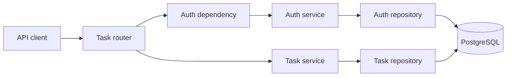

# FastAPI Modular Monolith

I built this project to test the modular monolithic architecture and practice system design and deployment. The task manager is a deliberately small domain for exploring how to divide a backend into modules, enforce ownership, and run an API with a separate database process.

**Stack:** Python 3.15, FastAPI, Pydantic, SQLAlchemy, Psycopg, PostgreSQL, Redis.

## Architecture

The application is structured as a **modular monolith organized by vertical feature slices, with a layered architecture inside each module**:

| Module | Responsibility |
| --- | --- |
| [`auth`](app/modules/auth) | Handles login and logout, creates and revokes sessions, validates bearer tokens, and rate-limits login attempts. |
| [`users`](app/modules/users) | Owns registration, profile changes, credential verification, and account deletion. |
| [`tasks`](app/modules/tasks) | Owns task operations, enforces ownership, and presents task lists in cursor-based pages. |

Within a module, the **router → service → repository** flow gives each layer a clear job.

| Layer | Responsibility |
| --- | --- |
| Router | Handles HTTP input, resolves dependencies, and maps service errors to status codes. |
| Service | Coordinates the use case and delegates persistence to repositories. |
| Repository | Runs SQLAlchemy queries and owns write transactions. |
| Schemas and models | Pydantic schemas define the API contract. SQLAlchemy models define tables, relationships, indexes, and constraints. |

Modules call each other in-process. For example, the auth service calls the users service to verify credentials. The users service returns the authenticated user ID and keeps password hashes inside its own module. Shared configuration and SQLAlchemy session setup live in [`app/core`](app/core) and [`app/db`](app/db). The shared database makes cross-module constraints possible, so schema changes that affect multiple modules need to be coordinated.

## Protected request flow

A task update shows how authentication and authorization work together.



1. FastAPI supplies a request-scoped SQLAlchemy session and resolves `get_current_session()` before running the protected route handler.
2. The auth service hashes the bearer token and looks up an unexpired session. The dependency supplies the authenticated user ID or returns `401`.
3. The task router passes the task ID, authenticated user ID, and validated update to the task service. The repository includes both IDs in the SQL `UPDATE`, so the ownership check and write happen in the same statement.
4. The API returns `404` for both a missing task and a task owned by someone else. Account operations use the authenticated user ID through `/users/me`.

## System design decisions

- **Opaque sessions.** PostgreSQL stores a token digest, user ID, and expiration. Protected requests pay for an indexed session lookup, which lets logout revoke the session for subsequent requests. Passwords are hashed with Argon2, and validation error responses omit submitted values.
- **Database constraints.** PostgreSQL enforces unique emails and foreign keys. Deleting an account also deletes its tasks and sessions through cascading foreign keys.
- **Redis login rate limiting.** An atomic Lua script checks counters shared by API workers. Login allows 20 attempts per IP and 10 per email in a 60-second window. Redis expires the counters automatically. Login returns `429` with `Retry-After` when a limit is reached and `503` when Redis is unavailable. Existing sessions continue to use PostgreSQL.
- **Cursor pagination.** Task lists are scoped to the authenticated owner and ordered by task ID. The `(owner_id, id)` index supports that query. The repository fetches one extra row to determine whether another page exists, saving a separate count query. The default page size is 50, with a maximum of 100.
- **Deployment boundary.** A single Linux VM can run the HTTPS reverse proxy, Uvicorn, PostgreSQL, and Redis as separate processes. PostgreSQL and Redis can listen on loopback so clients reach the API through HTTPS. This setup provides practice with process management, database roles, connection pooling, and backups.

## Run locally

Create a PostgreSQL database and give the application role permission to create tables in its schema. Copy [`.env.example`](.env.example) to `.env` and set `DATABASE_URL` to a working connection string. `AUTH_SESSION_TTL_SECONDS` defaults to `28800`.

Start Redis or Valkey for login. `REDIS_URL` defaults to `redis://127.0.0.1:6379/0`.

```bash
python3.15 -m venv .venv
.venv/bin/python -m pip install -r requirements.txt
.venv/bin/python -m uvicorn app.main:app --reload
```

Open `http://127.0.0.1:8000/docs` to exercise the API. Startup creates missing tables with SQLAlchemy. For a deployment with existing data, versioned schema migrations and a tested backup-and-restore process are the next parts of the design to exercise.
